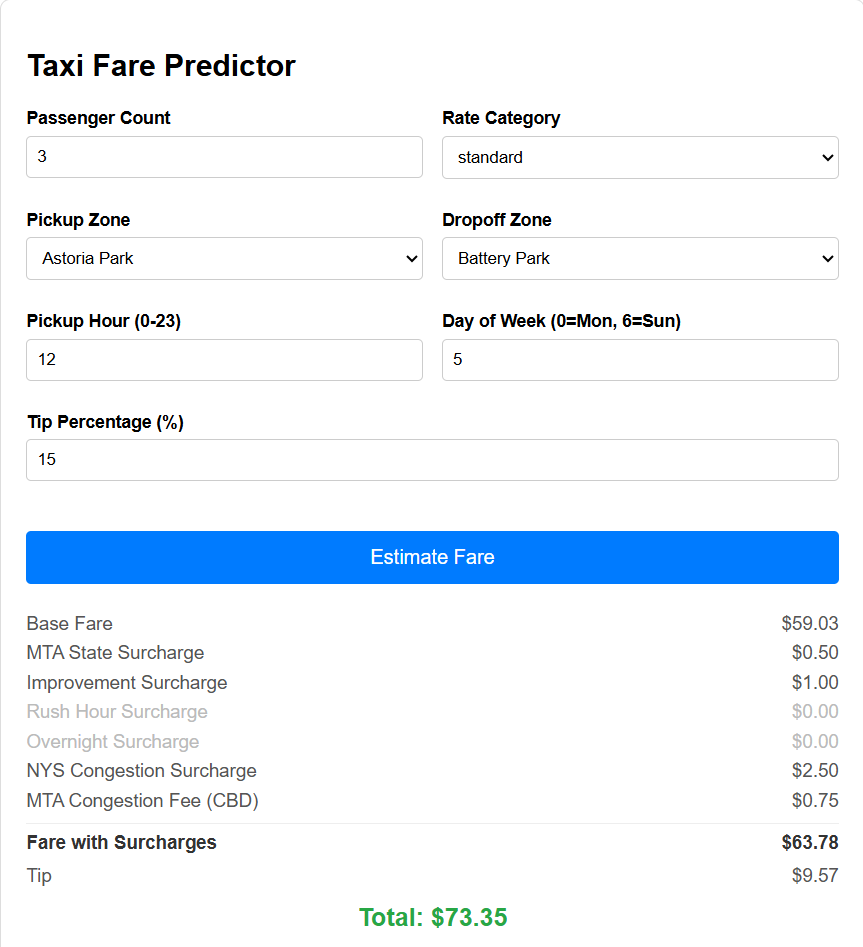
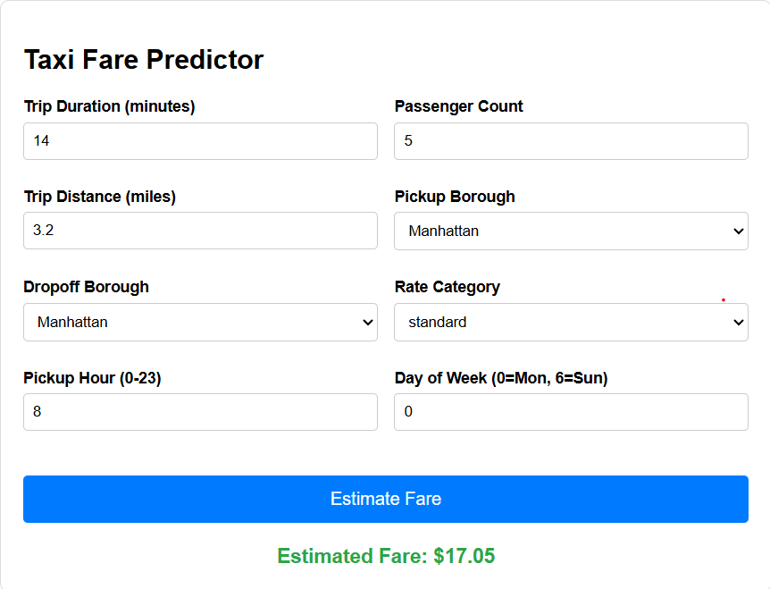
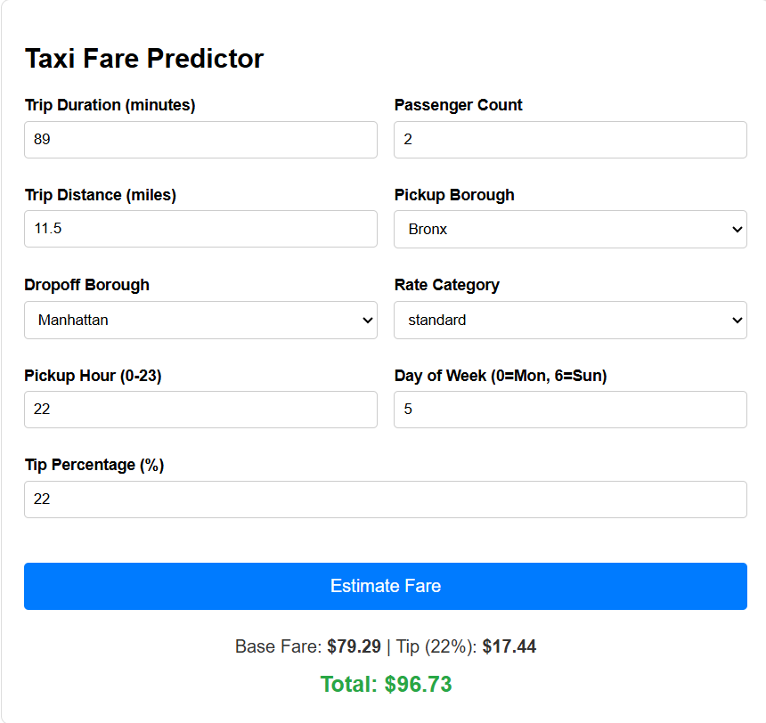
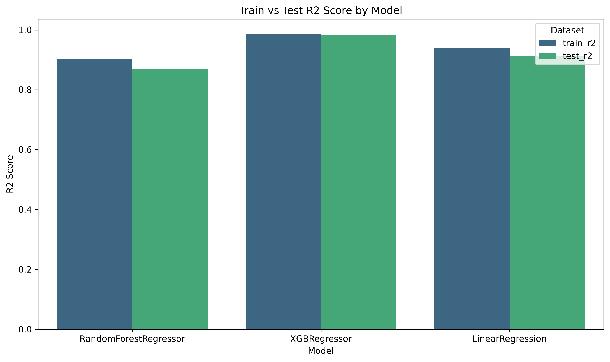
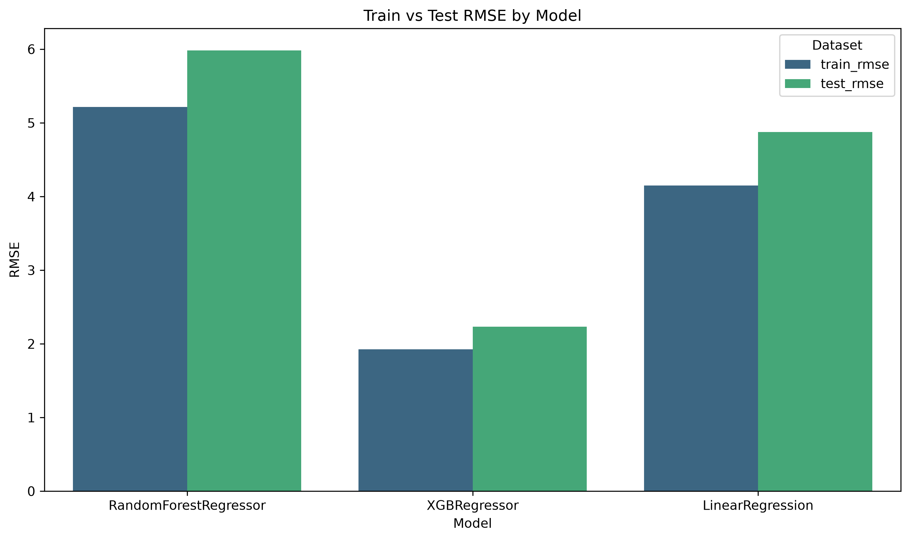
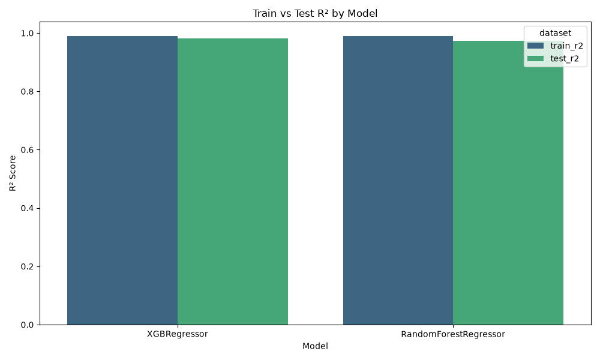
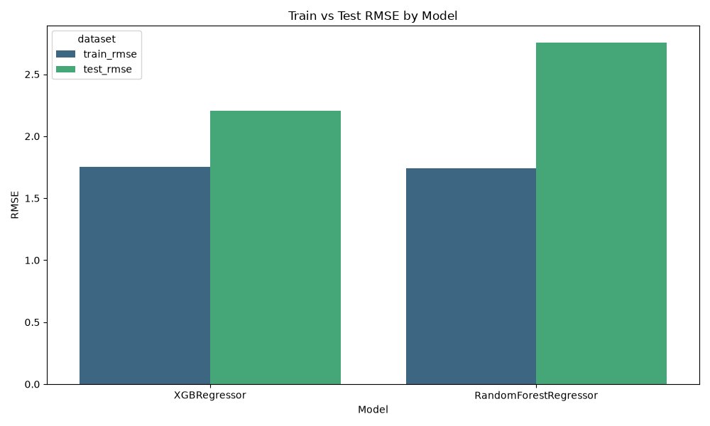

# NYC Taxi Fare Predictor


Predicts the fare of a NYC yellow taxi trip from just a pickup zone, dropoff zone, passenger count and pickup time — no trip distance or duration required — with a full breakdown of NYC taxi surcharges on top of the model's predicted base fare, served through a FastAPI browser UI.



Raw data: [NYC TLC Trip Record Data](https://www.nyc.gov/site/tlc/about/tlc-trip-record-data.page)

## Results

Metrics for the candidate production models. Linear regression was used as an initial baseline for the more complex models. XGBoost and Random Forest were tuned with a randomised cross-validation search over a parameter grid, and all training runs were logged with MLflow.

| Model | R² | RMSE ($) |
|---|---|---|
| Linear Regression | 0.914 | 4.874 |
| Random Forest (tuned) | 0.971 | 2.819 |
| **XGBoost (tuned)** | **0.982** | **2.209** |

XGBoost was selected as the production model — despite similar training RMSE to Random Forest, it had a lower test RMSE, indicating better generalisation to unseen data. See `notebooks/model_comparison.ipynb` for the full comparison. The chosen model was registered in MLflow under the `production` alias (`src/model_versioning.py`) so it can be loaded at inference time.

> **Note:** these metrics were computed on real per-trip distance and duration. At inference time the model receives zone-pair averages instead (see [Key Design Decisions](#key-design-decisions)), so real-world accuracy is expected to be lower.

## How It Works

```
raw trip data
      │
      ▼
cleaning (src/cleaning.py)
      │
      ▼
feature engineering (src/features.py)
  trip_duration · pickup_hour/dayofweek · rate_category · is_airport_trip
      │
      ▼
zone lookup tables (src/features.py)
  mean trip distance/duration per PU→DO zone pair, 5-stage fallback chain
      │
      ▼
XGBoost model (tracked & served via MLflow)
      │
      ▼
predicted base fare
      │
      ▼
+ NYC surcharges (src/predict.py)
  MTA state · improvement · rush hour · overnight · NYS congestion · CBD fee
      │
      ▼
final fare estimate (+ optional tip)
      │
      ▼
FastAPI browser UI (src/interface.py)
```

## Demo

The FastAPI interface (`src/interface.py`) lets the user pick pickup and dropoff zones from all NYC taxi zones and returns an itemised fare estimate, including surcharges and an optional tip.

| Final version with surcharges |
|---|
|  |

Earlier iterations of the interface, before the modelling approach changed to taxi zones:

| First version | With tip feature |
|---|---|
|  |  |

## Key Design Decisions

**Cold-start problem for trip distance/duration at inference time.** The model was trained on real per-trip `trip_distance`/`trip_duration`, but a user requesting a fare estimate only knows their pickup and dropoff zones — not the trip's real distance or duration. This is solved with a pair of 256×256 PU×DO zone matrices (mean historical distance and duration between every zone pair), looked up by zone ID at prediction time in place of the missing real values.

Not every one of the ~65,000 possible zone pairs appears in the historical data, so the matrices are built via a 5-stage fallback chain (`src/features.py`), restricted to the training period only (via `time_sorted_split_df()`) to avoid leaking test-period trips into the lookup values:

1. `create_zone_matrix()` — direct mean of the value per PU/DO zone pair
2. `transpose_fillna()` — missing A→B filled from observed B→A (distance/duration between two fixed points is roughly symmetric)
3. `intra_zone_fillna()` — same-zone (PU == DO) trips filled with a fixed default (0.8 miles / 8.0 minutes), since there's no reverse trip to borrow from
4. `borough_mean_fillna()` — remaining gaps filled from the mean value for that pair's boroughs
5. any final gaps filled with the global mean across the whole matrix

```python
from features import time_sorted_split_df, build_zone_lookup

df_train, df_test = time_sorted_split_df(df, sort_index='tpep_pickup_datetime', test_proportion=0.2)

distance_lookup = build_zone_lookup(df_train, value_col='trip_distance')
duration_lookup = build_zone_lookup(df_train, value_col='trip_duration')
```

**Layering a rule-based fare structure on top of the ML prediction.** Rather than asking the model to learn NYC's surcharge rules from data, `calculate_surcharges()` (`src/predict.py`) applies them deterministically according to TLC's published rules — flat surcharges (MTA state, improvement), time-based surcharges (rush hour, overnight), and congestion-related fees (NYS Congestion Surcharge for Manhattan-related trips, and the MTA Congestion/CBD fee using an exact, data-derived list of CBD zone IDs). This keeps the model focused on predicting the base metered fare, and keeps the surcharge logic auditable and easy to update if TLC rates change.

```python
from predict import predict_fare

predict_fare(
    passenger_count=2,
    pickup_zone='JFK Airport',
    dropoff_zone='Midtown Center',
    rate_category='standard',
    pickup_hour=14,
    pickup_dayofweek=2
)
```

Returns a dictionary with the model's predicted base fare, an itemised surcharge breakdown, and the total. An optional tip can be added on top via `optional_tip(fare, tip_percentage)`.

**Known limitation:** because the model was trained on real, noisy per-trip distance/duration but predicts from smoothed zone-pair averages, there is a train/inference distribution mismatch — real-world accuracy is expected to be somewhat lower than the test metrics above, which were computed on real trip data.

## Project Structure

```
taxi-fare-predictor/
├── .github/workflows/ci.yml   # CI: lint + tests on Python 3.11 and 3.12
│
├── data/                      # Lookup tables and raw data (CSV/Parquet are gitignored)
│   ├── model_training_columns.json
│   ├── congestion_zone_ids.json
│   ├── taxi_zone_lookup.csv
│   ├── distance_lookup.csv
│   ├── duration_lookup.csv
│   └── yellow_tripdata_2026-01.parquet
│
├── graphs/                    # Model performance plots and UI screenshots
│
├── notebooks/
│   ├── eda.ipynb              # Exploratory data analysis
│   └── model_comparison.ipynb # Training, tuning and model comparison
│
├── src/
│   ├── cleaning.py            # Data loading and cleaning (DuckDB)
│   ├── features.py            # Feature engineering & zone lookup tables
│   ├── pipeline.py            # ML pipeline construction
│   ├── train_and_tune.py      # Model training, tuning & MLflow logging
│   ├── model_versioning.py    # Promotes a run to the 'production' alias in MLflow
│   ├── predict.py             # Inference & surcharge calculation
│   └── interface.py           # FastAPI app and browser UI
│
├── tests/                     # pytest unit tests for every module in src/
│
├── requirements.txt
└── README.md
```

## Running Locally

```bash
git clone https://github.com/Calum1888/taxi-fare-predictor.git
cd taxi-fare-predictor
pip install -r requirements.txt
```

The trip data, lookup tables and MLflow database aren't committed (they're too large), so to run the app from scratch:

1. Download a month of yellow taxi trip data (Parquet) and `taxi_zone_lookup.csv` from the [TLC Trip Record Data](https://www.nyc.gov/site/tlc/about/tlc-trip-record-data.page) page into `data/`.
2. Run `notebooks/model_comparison.ipynb` to build the zone lookup tables, train the models and register the production model in MLflow.
3. Set `TRACKING_URI` in `src/predict.py` to point at your local `mlflow.db`.
4. Start the app and open http://127.0.0.1:8000:

```bash
uvicorn src.interface:app --reload
```

Run the tests with:

```bash
pytest -v
```

## Background & Process

<details>
<summary>Full EDA, training, and tuning walkthrough</summary>

### EDA and Feature Engineering (`notebooks/eda.ipynb`)

Exploratory data analysis of the taxi trip dataset, looking at the distributions of fare amount, trip distance and trip duration.

`src/cleaning.py` contains `load_and_clean()`, which takes the file paths for the trip data and taxi zone codes and builds a DuckDB SQL query that filters the data using criteria decided during EDA.

`src/features.py` performs feature engineering, including trip duration, pickup hour/day of week, and flags for flat-rate airport trips to JFK and Newark.

### Initial Training (`notebooks/model_comparison.ipynb`)

The training classes and methods in `src/train_and_tune.py` allow an initial training run for any model, plus a randomised cross-validation search to tune hyperparameters.

Linear Regression, XGBoost and Random Forest models were trained and compared on RMSE and R².





XGBoost was the best-performing model of the three, with the highest R² and lowest RMSE.

### Hyperparameter Tuning

XGBoost and Random Forest were tuned using `RandomizedSearchCV` over a grid of parameters.





XGBoost was chosen as the production model — despite similar training RMSE, it showed a significantly lower test RMSE than Random Forest, indicating better generalisation.

### Change in Modelling Approach: Taxi Zone IDs

The initial models encoded pickup/dropoff locations as one of NYC's five boroughs. This kept encoding simple but limited real-world usability — the model couldn't distinguish between a 100-metre trip and one across the length of Manhattan, and users don't know their trip distance/duration in advance anyway. This motivated the move to the 256 TLC taxi zones and the zone lookup tables described above.

</details>

## Future Work

- Deploy the FastAPI app publicly (e.g. Hugging Face Spaces) with the model exported as a standalone artefact
- Evaluate the model on the test set using zone-lookup features instead of real distance/duration, to report a metric that matches inference conditions
- Compare against a naive baseline (mean historical fare per zone pair)
- Replace the hour/day-of-week inputs in the UI with a date/time picker